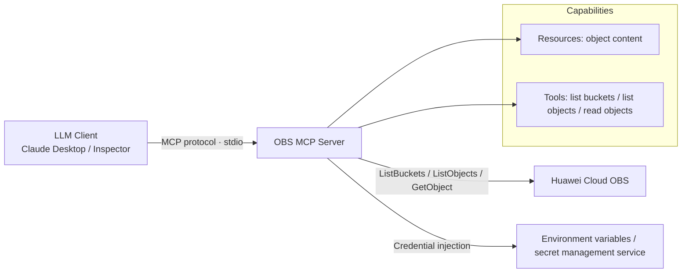

# Object Storage MCP Server (OBS MCP Server)


> A server implementation based on the Model Context Protocol (MCP) that exposes objects stored in Huawei Cloud Object Storage Service (OBS) — such as PDFs and text files — to large language model clients as Resources and Tools.

> Chapter 1 "Title and Badges" is the H1 heading and badge line above.

---

## 2. Introduction / Overview

This service targets developers and solution teams that need a large language model to "read directly" from files in Huawei Cloud OBS. It wraps object storage capabilities as standard MCP tools and resources. Once mounted into any MCP-compatible client (such as Claude Desktop or MCP Inspector), the model can list buckets, browse objects, and read object content without manually downloading files or writing glue code. It is suitable for scenarios such as knowledge base Q&A, document retrieval augmentation, and object storage content preview.

---

## 3. Table of Contents

- [1. Title and Badges](#object-storage-mcp-server-obs-mcp-server)
- [2. Introduction / Overview](#2-introduction--overview)
- [4. Architecture Diagram](#4-architecture-diagram)
- [5. Solution Highlights](#5-solution-highlights)
- [6. Cloud Services and Costs](#6-cloud-services-and-costs)
- [7. Prerequisites](#7-prerequisites)
- [8. Quick Start / One-Click Deployment](#8-quick-start--one-click-deployment)
- [9. Step-by-Step Deployment](#9-step-by-step-deployment)
- [10. Usage / Verification](#10-usage--verification)
- [11. Resource Cleanup](#11-resource-cleanup)
- [12. Detailed Description](#12-detailed-description)
- [13. Dependencies and Acknowledgments](#13-dependencies-and-acknowledgments)
- [14. FAQ / Troubleshooting](#14-faq--troubleshooting)
- [15. Contributing Guidelines](#15-contributing-guidelines)
- [16. License](#16-license)
- [17. Submitter](#17-submitter)

---

## 4. Architecture Diagram



**Flow description**: the OBS MCP Server runs over standard input / output (stdio) and does not expose any port externally. The client initiates calls through the MCP protocol, and the server uses the OBS SDK (`esdk-obs-python`) to read object storage data and return it to the model context. Credentials are injected only through environment variables or a secret management service, and are never written into code or the repository.

---

## 5. Solution Highlights

- **Standard MCP protocol**: built on the Model Context Protocol, it can be mounted into any MCP-compatible client with no custom interfaces required.
- **Direct object storage reads**: natively integrates with Huawei Cloud OBS, with the three core capabilities — list buckets / list objects / read object — available out of the box.
- **Dual exposure as resources and tools**: object content can be loaded into context as Resources, or actively invoked by the model as Tools.
- **Secure credential injection**: access keys are injected through the `HW_ACCESS_KEY` / `HW_SECRET_KEY` environment variables or a secret management service, with zero plaintext credentials in the repository.
- **One-click publishing**: distributed via `uv` / `uvx`, supporting both local development and PyPI release.
- **Built-in resource limits**: at most 1,000 objects are returned per call, preventing very large buckets from overwhelming the context.

---

## 6. Cloud Services and Costs

**Huawei Cloud services involved**:

| Category | Huawei Cloud Service |
|---|---|---|
| Storage | Object Storage Service (OBS) — buckets + objects |
| Identity | IAM — users / access keys / read-only policies |


---

## 7. Prerequisites

- **Account and permissions**: you have a Huawei Cloud account, and Object Storage Service (OBS) is activated in the target region (default `cn-north-4`); the credentials used have read permission on the target bucket (granting a read-only policy only is recommended).
- **Credential security**: the Access Key ID and Secret Access Key are injected only through environment variables or a secret management service, and **must not be written into code or committed to the repository**.
- **Runtime and tool versions**:
  - `python3` ≥ 3.8 (service runtime environment)
  - `uv` ≥ 0.4 (recommended, for dependency management and running scripts; `pip` can be used instead)
  - An MCP-compatible client (such as Claude Desktop or MCP Inspector)
- **Region constraints**: the default target region is `cn-north-4`; switching regions requires updating both `OBS_ENDPOINT` and `OBS_REGION`.

---

## 8. Quick Start / One-Click Deployment

This service is a Python package and runs through `uv` / `uvx`; no separate "deployment" is required.

**Option 1: local development (not published)**

```json
{
  "mcpServers": {
    "obs-mcp-server": {
      "command": "uv",
      "args": [
        "--directory",
        "/path/to/obs-mcp-server",
        "run",
        "obs-mcp-server"
      ]
    }
  }
}
```

**Option 2: published (PyPI)**

```json
{
  "mcpServers": {
    "obs-mcp-server": {
      "command": "uvx",
      "args": ["obs-mcp-server"]
    }
  }
}
```

After writing the configuration above into the client configuration file, the client can launch this service over stdio.

---

## 9. Step-by-Step Deployment

```bash
# Step 1: get the code
git clone <repository URL> obs-mcp-server
cd obs-mcp-server

# Step 2: sync dependencies (expected: .venv and the dependency lock are generated)
uv sync

# Step 3: configure access credentials (expected: environment variables take effect; no output means success)
export HW_ACCESS_KEY="<your access key ID>"
export HW_SECRET_KEY="<your secret access key>"
export OBS_REGION="cn-north-4"
export OBS_BUCKET="<target bucket name>"

# Step 4: add the mcpServers configuration from Chapter 8 to the client configuration file
# Step 5: start the client; the MCP service is launched by the client over stdio
```

> To create the bucket and read-only IAM credentials using infrastructure as code, refer to the Terraform files in the repository's `infra/` directory (requires `terraform init && terraform apply`, and you must fill in the variables yourself).

---

## 10. Usage / Verification

**Minimal example**: ask the model in the client to list the OBS buckets under the current account.

**Verification methods** (confirming the service works):

1. **The service can start**: run `uv run obs-mcp-server`; the process stays resident over stdio and does not exit with an error.
2. **Tools are registered**: the client shows three tools — `ListBuckets` / `ListObjects` / `GetObject`.
3. **Listing works**: calling `ListBuckets` returns the bucket list under the target account; calling `ListObjects` (with a bucket name and prefix) returns the object list.
4. **Reading works**: calling `GetObject` (with the full key) returns the object content and type; text / PDF can be correctly loaded into the model context.
5. **Credential isolation**: the `env.example` file in the repository contains placeholders only and no plaintext keys; real keys come from the runtime environment and are not committed to version control.
6. **Debugging works** (optional): start debugging with MCP Inspector:

```bash
npx @modelcontextprotocol/inspector uv --directory /path/to/obs-mcp-server run obs-mcp-server
```

After startup, Inspector prints a debug address that can be opened in a browser.

---

## 11. Resource Cleanup

```bash
# If resources were created with the Terraform code under infra/, destroy them to avoid ongoing charges
cd infra && terraform destroy -auto-approve

# Clean up local code and the virtual environment (optional)
cd .. && rm -rf obs-mcp-server
```

> ⚠️ Object storage is billed continuously based on the amount of data stored. If data has already been written to the bucket, manually delete the objects or configure a lifecycle rule in the console first, and only then run destroy, to avoid leftover storage charges.

---

## 12. Detailed Description

### 12.1 Workflow

After startup, the server listens on the MCP protocol (stdio). When the client makes a tool call, the server uses the OBS SDK to read object storage:

- `ListBuckets`: returns all buckets under the current account.
- `ListObjects`: returns some or all objects in the specified bucket (at most 1,000 per call), with prefix filtering supported.
- `GetObject`: reads a single object by its full key, returning the content and MIME type.

Resources currently support mainly PDF and text documents, so the model can load them directly into context.

### 12.2 Interface Description (Tools)

| Tool | Input | Description |
|---|---|---|
| `ListBuckets` | none | Returns all buckets under the account |
| `ListObjects` | `bucket`, `prefix` (optional), `max_keys` (default 1000) | Lists objects, can be filtered by prefix |
| `GetObject` | `bucket`, `key` (full key) | Reads the content and type of a single object |

### 12.3 Configuration Items

| Item | Environment Variable | Description |
|---|---|---|
| Region | `OBS_REGION` | Default `cn-north-4` |
| Access Key ID | `HW_ACCESS_KEY` | Injected via environment variable / secret management service |
| Secret Access Key | `HW_SECRET_KEY` | Injected via environment variable / secret management service |
| Target bucket | `OBS_BUCKET` | Optional; limits the default bucket to operate on |
| Endpoint | `OBS_ENDPOINT` | Optional; pins a regional endpoint; if unset, the OBS global endpoint is used |

The OBS global endpoint `https://obs.myhuaweicloud.com` is used by default; the SDK routes automatically to the corresponding region based on the bucket name.

---

## 13. Dependencies and Acknowledgments

- **Main dependencies**: `mcp` (Model Context Protocol Python SDK), `esdk-obs-python` (Huawei Cloud OBS SDK), `uv` (dependency and runtime management).
- **Acknowledgments**: this service is implemented on the open Model Context Protocol standard; object storage capabilities connect to Huawei Cloud OBS. Thanks to the official Huawei Cloud documentation and the OBS SDK for their interface references.

---

## 14. FAQ / Troubleshooting

**Q1: The client does not show any tools after the service starts?**
Check that the `command` and `--directory` paths in the client configuration file are correct, and that `uv` is on the system PATH. A stdio service has no port; it must be launched by the client and cannot be accessed independently.

**Q2: It reports "no permission" or "access denied"?**
Check whether `HW_ACCESS_KEY` / `HW_SECRET_KEY` are correct, and whether those credentials have read-only permission on the target bucket. Binding only an object storage read-only policy is recommended.

**Q3: More than 1,000 objects to list?**
A single call returns at most 1,000 objects. If you need more, use prefix-based pagination (segmented listing) on the client or caller side.

**Q4: Still hitting the old region after switching regions?**
Update both `OBS_REGION` and `OBS_ENDPOINT`, and make sure the region where the bucket resides matches the configuration.

**Q5: How do I debug locally?**
Use MCP Inspector: `npx @modelcontextprotocol/inspector uv --directory /path/to/obs-mcp-server run obs-mcp-server`, then open the address it provides in a browser to call the tools step by step.

---

## 15. Contributing Guidelines

Contributions that add new tool capabilities, improve object reading logic, or refine the documentation are welcome. Please read the repository conventions first (secure credential injection, zero plaintext keys, resource limits) and submit everything through PRs. For major changes (adding tools, changing the default region or permission model), open an Issue to discuss first. See `CONTRIBUTING.md` for details.

---

## 16. License

For the badges at the top, see [the title section](#object-storage-mcp-server-obs-mcp-server).

This repository is released under the **MIT-0** license; see the `LICENSE` file for details. This license does not require retaining copyright notices or attribution, and may be used freely for both commercial and non-commercial purposes.

---

## 17. Submitter

- **Submitter**: zhangcheng123321
