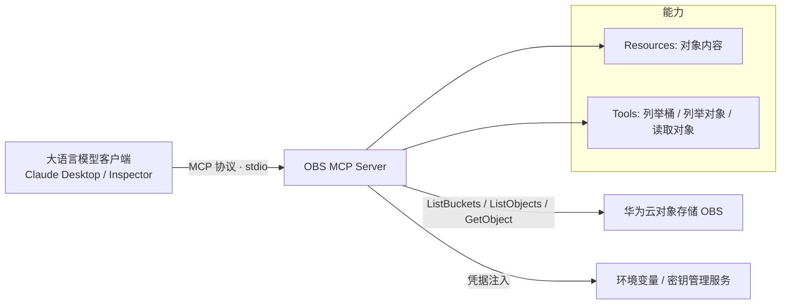

# 对象存储 MCP 服务（OBS MCP Server）


> 一个基于 Model Context Protocol（MCP）的服务器实现，用于把华为云对象存储（Object Storage Service，OBS）中的对象（如 PDF、文本文件等）暴露给大语言模型客户端，作为资源（Resources）与工具（Tools）使用。

> 第 1 章「标题与徽章」即上方 H1 标题与徽章行。

---

## 2. 简介 / 概述

本服务面向需要让大语言模型「直接读取」华为云 OBS 中文件的开发者与解决方案团队。它把对象存储能力封装为标准 MCP 工具与资源，挂载到任意兼容 MCP 的客户端（如 Claude Desktop、MCP Inspector）后，模型即可列举桶、浏览对象、读取对象内容，无需手工下载或编写胶水代码。适用于知识库问答、文档检索增强、对象存储内容预览等场景。

---

## 3. 目录

- [1. 标题与徽章](#对象存储-mcp-服务obs-mcp-server)
- [2. 简介 / 概述](#2-简介--概述)
- [4. 架构图](#4-架构图)
- [5. 方案亮点](#5-方案亮点)
- [6. 涉及云服务与费用](#6-涉及云服务与费用)
- [7. 前置条件](#7-前置条件)
- [8. 快速开始 / 一键部署](#8-快速开始--一键部署)
- [9. 分步部署](#9-分步部署)
- [10. 使用方法 / 验证](#10-使用方法--验证)
- [11. 清理资源](#11-清理资源)
- [12. 详细说明](#12-详细说明)
- [13. 依赖与致谢](#13-依赖与致谢)
- [14. FAQ / 故障排除](#14-faq--故障排除)
- [15. 贡献指南](#15-贡献指南)
- [16. 许可证](#16-许可证)
- [17. 提交者](#17-提交者)

---

## 4. 架构图



**流程说明**：OBS MCP Server 以标准输入 / 输出（stdio）方式运行，不对外暴露端口。客户端通过 MCP 协议发起调用，服务端使用 OBS SDK（`esdk-obs-python`）读取对象存储数据并返回给模型上下文。凭据仅通过环境变量或密钥管理服务注入，不写入代码或仓库。

---

## 5. 方案亮点

- **标准 MCP 协议**：基于 Model Context Protocol 实现，可挂载到任意兼容 MCP 的客户端，无需定制接口。
- **对象存储直读**：原生对接华为云 OBS，列举桶 / 列举对象 / 读取对象三个核心能力开箱即用。
- **资源 + 工具双暴露**：对象内容既可作为 Resources 载入上下文，也可作为 Tools 由模型主动调用。
- **凭据安全注入**：访问密钥通过 `HW_ACCESS_KEY` / `HW_SECRET_KEY` 环境变量或密钥管理服务注入，仓库内零明文凭据。
- **一键发布**：基于 `uv` / `uvx` 分发，支持本地开发与 PyPI 发布两种形态。
- **内置资源约束**：单次最多返回 1,000 个对象，避免超大桶拖垮上下文。

---

## 6. 涉及云服务与费用

**涉及的华为云服务**：

| 类别 | 华为云服务 |
|---|---|---|
| 存储 | 对象存储 OBS（桶 + 对象） |
| 身份 | IAM（用户 / 访问密钥 / 只读策略） |


---

## 7. 前置条件

- **账号与权限**：已开通华为云账号，目标区域（默认 `cn-north-4`）已开通对象存储 OBS 服务；所用凭据对目标桶具备对象存储读取权限（建议仅授予只读策略）。
- **凭据安全**：访问密钥（Access Key ID）与私密访问密钥（Secret Access Key）仅以环境变量或密钥管理服务注入，**不可写入代码或提交到仓库**。
- **运行时与工具版本**：
  - `python3` ≥ 3.8（服务运行环境）
  - `uv` ≥ 0.4（推荐，用于依赖管理与脚本运行；也可用 `pip` 替代）
  - 兼容 MCP 的客户端（如 Claude Desktop 或 MCP Inspector）
- **区域约束**：默认目标区域 `cn-north-4`；切换区域需同步更新 `OBS_ENDPOINT` 与 `OBS_REGION`。

---

## 8. 快速开始 / 一键部署

本服务为 Python 包，通过 `uv` / `uvx` 运行，无需独立「部署」。

**方式一：本地开发形态（未发布）**

```json
{
  "mcpServers": {
    "obs-mcp-server": {
      "command": "uv",
      "args": [
        "--directory",
        "/path/to/obs-mcp-server",
        "run",
        "obs-mcp-server"
      ]
    }
  }
}
```

**方式二：已发布形态（PyPI）**

```json
{
  "mcpServers": {
    "obs-mcp-server": {
      "command": "uvx",
      "args": ["obs-mcp-server"]
    }
  }
}
```

将上述配置写入客户端配置文件后，客户端即可通过 stdio 拉起本服务。

---

## 9. 分步部署

```bash
# 步骤 1：获取代码
git clone <本仓库地址> obs-mcp-server
cd obs-mcp-server

# 步骤 2：同步依赖（预期：生成 .venv 与依赖锁）
uv sync

# 步骤 3：配置访问凭据（预期：环境变量生效，无输出即成功）
export HW_ACCESS_KEY="<你的访问密钥ID>"
export HW_SECRET_KEY="<你的私密访问密钥>"
export OBS_REGION="cn-north-4"
export OBS_BUCKET="<目标桶名>"

# 步骤 4：在客户端配置文件中加入第 8 章的 mcpServers 配置
# 步骤 5：启动客户端，MCP 服务随客户端以 stdio 方式拉起
```

> 如需用基础设施即代码创建桶与只读 IAM 凭据，可参考仓库 `infra/` 目录下的 Terraform 文件（需 `terraform init && terraform apply`，并自行填写变量）。

---

## 10. 使用方法 / 验证

**最简示例**：在客户端中让模型列举当前账号下的 OBS 桶。

**验证方法**（确认服务可用）：

1. **服务可启动**：执行 `uv run obs-mcp-server`，进程以 stdio 方式常驻且不报错退出。
2. **工具已注册**：客户端可看到三个工具 —— `ListBuckets` / `ListObjects` / `GetObject`。
3. **列举可用**：调用 `ListBuckets` 返回目标账号下的桶列表；调用 `ListObjects`（指定桶名与前缀）返回对象列表。
4. **读取可用**：调用 `GetObject`（指定完整键名）返回对象内容与类型；文本 / PDF 可被模型正确载入上下文。
5. **凭据隔离**：仓库内 `env.example` 仅含占位符，无明文密钥；真实密钥来自运行环境，未提交进版本控制。
6. **调试可用**（可选）：使用 MCP Inspector 启动调试：

```bash
npx @modelcontextprotocol/inspector uv --directory /path/to/obs-mcp-server run obs-mcp-server
```

启动后 Inspector 会给出浏览器可访问的调试地址。

---

## 11. 清理资源

```bash
# 若通过 infra/ 下的 Terraform 创建了资源，销毁以避免持续计费
cd infra && terraform destroy -auto-approve

# 清理本地代码与虚拟环境（可选）
cd .. && rm -rf obs-mcp-server
```

> ⚠️ 对象存储按存储量持续计费。如桶内已写入数据，请先手动清空对象或在控制台设置生命周期规则，再执行销毁，避免残留存储费用。

---

## 12. 详细说明

### 12.1 工作流程

服务端启动后监听 MCP 协议（stdio）。客户端发起工具调用时，服务端使用 OBS SDK 读取对象存储：

- `ListBuckets`：返回当前账号下全部桶。
- `ListObjects`：返回指定桶中部分或全部对象（单次最多 1,000 个），支持前缀过滤。
- `GetObject`：按完整键名读取单个对象，返回内容与 MIME 类型。

当前资源（Resources）主要支持 PDF 与文本类文档，便于模型直接载入上下文。

### 12.2 接口说明（工具）

| 工具 | 入参 | 说明 |
|---|---|---|
| `ListBuckets` | 无 | 返回账号下所有桶 |
| `ListObjects` | `bucket`、`prefix`（可选）、`max_keys`（默认 1000） | 列举对象，可按前缀过滤 |
| `GetObject` | `bucket`、`key`（完整键名） | 读取单个对象内容与类型 |

### 12.3 配置项

| 配置项 | 环境变量 | 说明 |
|---|---|---|
| 区域 | `OBS_REGION` | 默认 `cn-north-4` |
| 访问密钥 ID | `HW_ACCESS_KEY` | 通过环境变量 / 密钥管理服务注入 |
| 私密访问密钥 | `HW_SECRET_KEY` | 通过环境变量 / 密钥管理服务注入 |
| 目标桶 | `OBS_BUCKET` | 可选，限定默认操作桶 |
| 端点 | `OBS_ENDPOINT` | 可选，限定区域端点；不填则使用 OBS 全局端点 |

默认使用 OBS 全局端点 `https://obs.myhuaweicloud.com`，SDK 会按桶名自动路由到对应区域。

---

## 13. 依赖与致谢

- **主要依赖**：`mcp`（Model Context Protocol Python SDK）、`esdk-obs-python`（华为云 OBS SDK）、`uv`（依赖与运行管理）。
- **致谢**：本服务基于 Model Context Protocol 开放标准实现；对象存储能力对接华为云 OBS。感谢华为云官方文档与 OBS SDK 提供的接口参考。

---

## 14. FAQ / 故障排除

**Q1：服务启动后客户端看不到工具？**
确认客户端配置文件的 `command` 与 `--directory` 路径正确，且 `uv` 已在系统 PATH 中。stdio 服务无端口，需经客户端拉起，不能独立访问。

**Q2：报「无权限」或「拒绝访问」？**
检查 `HW_ACCESS_KEY` / `HW_SECRET_KEY` 是否正确，以及该凭据对目标桶是否具备只读权限。建议仅绑定对象存储只读策略。

**Q3：列举对象数量超过 1,000？**
单次调用最多返回 1,000 个对象。如需更多，请在客户端或调用侧使用前缀分页（分段列举）。

**Q4：切换区域后仍访问旧区域？**
同时更新 `OBS_REGION` 与 `OBS_ENDPOINT`，并确保桶所在区域与配置一致。

**Q5：如何本地调试？**
使用 MCP Inspector：`npx @modelcontextprotocol/inspector uv --directory /path/to/obs-mcp-server run obs-mcp-server`，浏览器打开其提供的地址即可逐步调用工具。

---

## 15. 贡献指南

欢迎补充新的工具能力、改进对象读取逻辑或完善文档。请先阅读仓库约定（凭据安全注入、零明文密钥、资源约束），统一通过 PR 提交；重大变更（新增工具、调整默认区域或权限模型）请先提 Issue 讨论。详见 `CONTRIBUTING.md`。

---

## 16. 许可证

顶部徽章见[标题区](#对象存储-mcp-服务obs-mcp-server)。

本库基于 **MIT-0** 许可证发布，详见 `LICENSE` 文件。该许可证不要求保留版权声明与署名，可自由用于商业与非商业用途。

---

## 17. 提交者

- **提交者**：zhangcheng123321
