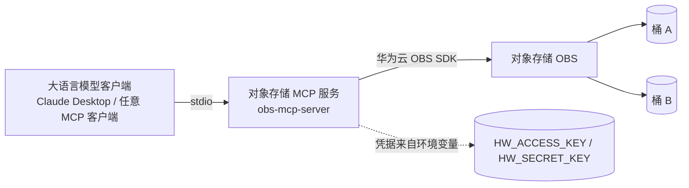

# 架构说明：对象存储 MCP 服务（OBS MCP Server）

本文档描述将对象存储访问能力封装为 Model Context Protocol（MCP）服务的华为云实践架构。

## 总体架构

**能力说明**：MCP 服务通过标准输入 / 输出（stdio）与大语言模型客户端通信，把对象存储的数据抽象为三类能力：

- `ListBuckets`：列出账号下的桶。
- `ListObjects`：列出指定桶内的对象（支持前缀过滤，单次上限 1,000）。
- `GetObject`：读取指定对象内容。

## 组件职责

| 组件 | 说明 |
|---|---|
| MCP 服务（obs-mcp-server） | Python 实现，基于 `mcp` 框架与 `esdk-obs-python`（OBS SDK）。暴露 Resources 与 Tools。 |
| 对象存储（OBS） | 华为云对象存储服务，存放被访问的文档 / 数据对象。 |
| 凭据 | 通过环境变量 `HW_ACCESS_KEY` / `HW_SECRET_KEY` 注入，不落盘、不进代码。 |

## 资源映射（原架构 → 华为云）

原样例用于访问另一云厂商的对象存储，本实践将其等价复刻到华为云对象存储（OBS）。两者均为对象存储服务，核心操作（列举桶、列举对象、获取对象）一一对应，迁移工作量低。

## 运行形态

- 该服务为**进程内 stdio 服务**，无独立 Web 入口，需随 MCP 客户端一起拉起。
- 对象存储侧除桶本身外，不引入额外常驻算力，成本主要来自存储与请求，空闲时近乎为零。
- 网络访问控制建议配合桶策略 / 安全组，将访问来源限制在运维者或目标客户端所在网络。
